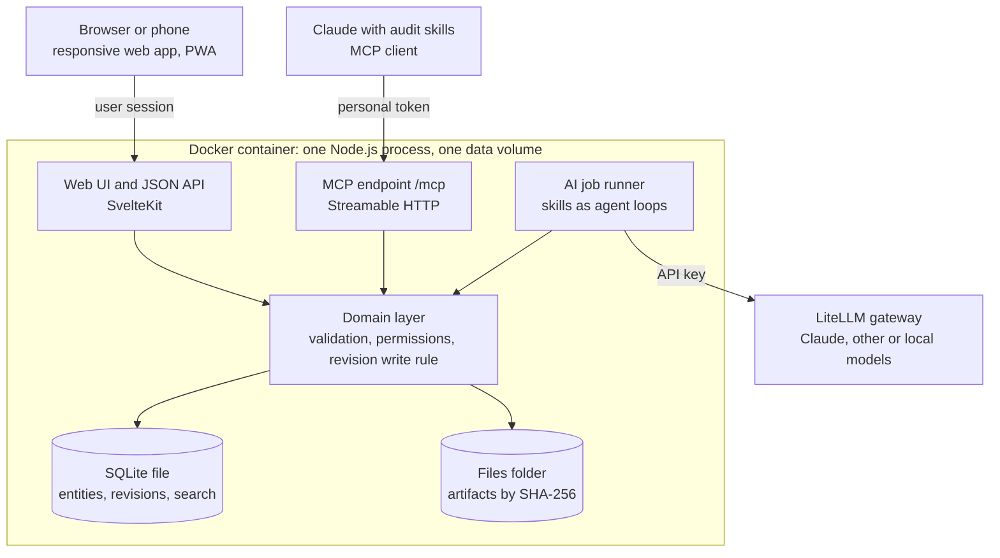

# Architecture and decisions

The app is a versioned audit database with a thin responsive UI and an MCP server, so an auditor or an AI skill can plan and run an engagement against the same records.

## Fixed decisions

| Topic | Decision |
| --- | --- |
| Users | Small auditor team. Named users, roles per engagement, authorship on every version. No auditee access. |
| Hosting | One Docker container with one data volume (SQLite file and files folder). Runs on a laptop first; the same image moves to a server or VPS. |
| Network | Private network first. A public HTTPS endpoint can be added later behind a reverse proxy. Nothing assumes localhost; every route requires login. |
| AI | In Claude through MCP, and as buttons in the app. AI logic is written once on the server and reached by both routes. |
| Models | Reached through LiteLLM, so Claude, other providers and local models all work. Model is set per action; an engagement can be limited to one model. |
| Findings | One finding per assessment unit (requirement in a scope). No per-criterion marks in the MVP. |
| Languages | English interface. Each engagement has a working language and a report language. Content is stored as received. |
| Standards | Full ISO clause text may be stored (licence held). Each source records a licence note. |
| Templates | Report templates ship with the skills and are used by both Claude skills and in-app actions. |

## Rules that shape the design

1. **Library versus engagement.** An engagement pins a specific version of each library requirement. Upgrading is an explicit action.
2. **Artifacts are not evidence.** An artifact is raw material. Evidence is the planned item it satisfies. The link between them is many-to-many and carries locator, excerpt and sufficiency.
3. **A finding sits on an external requirement and scope pair.** Internal requirements serve as criteria and explanation; they never get their own finding.
4. **AI proposes, humans approve.** Every AI write is a version authored "Claude on behalf of <user>". Evidence sufficiency and findings written by AI land as proposed. Approving a finding is possible only in the UI.
5. **Approved means locked.** An approval points at one exact version. Editing an approved finding reopens it.
6. **Client separation.** Each client is an Auditee and owns its internal sources. The domain layer refuses any read that would show one auditee's internal requirements in another auditee's engagement. Carry-over between engagements of the same auditee is an explicit, recorded choice, off by default.
7. **Missing evidence is not a non-conformity.** Insufficient evidence gives "no reasonable assurance". A non-conformity needs evidence that the requirement was not met.
8. **The plan is agreed as a whole.** Plan status (draft, sent, agreed) lives on the engagement, not on each event. Events stay editable; the app flags changes made after the plan was sent.
9. **Local models must prove tool calling.** A model that fails a short tool-calling check cannot run an AI action.

## Runtime

All three entry points call the same domain layer. It holds validation, permissions and the revision write rule, so UI, MCP and in-app AI cannot behave differently.

## Tech stack

| Layer | Choice | Why |
| --- | --- | --- |
| Language | TypeScript on Node.js | One language for UI, server and MCP. |
| Web framework | SvelteKit | Server and UI in one project, small output, simple forms. |
| UI | Responsive web app, installable as a PWA | One codebase for desktop and phone. |
| Database | SQLite in WAL mode with FTS5 | Zero administration, single file, fast enough for a small team. |
| Data access | Drizzle ORM with migrations | Typed schema; keeps a path to PostgreSQL. |
| Files | Folder on disk, content-addressed by SHA-256 | Immutable evidence, easy backup. |
| Text extraction | Server-side for PDF, DOCX and plain text at upload | Gives AI and search the text without reopening files. |
| MCP | Official MCP TypeScript SDK, Streamable HTTP at `/mcp`, same process | Same domain layer, same authorship. Per-user token identifies who the AI acts for. |
| In-app AI | Server-side agent loop calling LiteLLM with the same internal tools | One implementation of each AI step. |
| Auth | Local accounts, session cookie; personal tokens for MCP | No external identity provider needed. |
| Packaging | Docker image and Compose file with one data volume and an optional LiteLLM service | Same image on laptop, server or VPS. |
| Document export | DOCX and PDF from templates that ship with the skills | Outputs are saved back as artifacts of kind "generated report". |

Security baseline: full-disk encryption on the host, nightly encrypted backup of the data volume, no listening port outside localhost and the private network until a public endpoint is deliberately added with TLS.

## Versioning and authorship

One append-only `revision` table gives every item its full history.

- **Write rule.** Every create, update, delete and revert goes through one domain function. It writes the new state to the entity table and a full JSON snapshot to `revision` in the same transaction.
- **Recorded.** Version number, snapshot, timestamp, user, AI agent if any, channel (UI, MCP, in-app AI), optional note.
- **AI authorship.** An AI change always has both a user and an agent. There is no anonymous AI write.
- **Revert.** Reverting to version 3 creates a new version copying version 3 with `reverted_from = 3`. History is never rewritten.
- **Delete.** Sets a `deleted` flag in a new version. A deleted item can be restored by revert.
- **Links are items too.** Link rows are versioned the same way.
- **Files.** Artifact files are immutable. A corrected document is a new artifact. Only artifact metadata is versioned.
- **Pinning.** `engagement_requirement.pinned_version` and `finding.approved_version` point at exact revisions.
- **Concurrency.** Each write sends the version it was based on. If someone saved first, the write is refused.

Known gap from the prototype: requirement selection (which requirements are in the engagement) was not versioned there. In the app it is an `engagement_requirement` row and is versioned like everything else.
