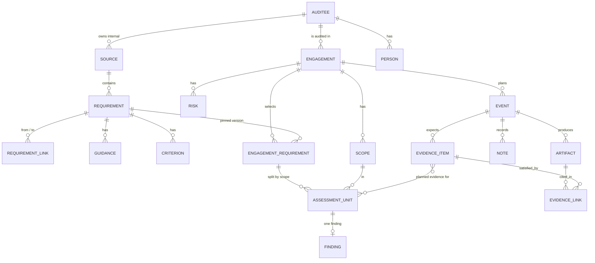

# Data model

Twenty-four entities in three groups: the library, the engagement set-up and the evidence trail. The assessment unit (one engagement requirement in one scope) is the pivot that evidence and findings attach to.

Every entity also carries `id`, `current_version`, `created_at`, `created_by` and `deleted`.

`revision` and `comment` attach to every entity and are left out of the diagram.

## Library (shared across engagements)

| Entity | Key fields | Notes |
| --- | --- | --- |
| Source | type (law, standard, internal document), title, edition, language, licence_note, auditee_id, artifact_id | auditee_id is empty for external sources. Internal sources belong to one auditee and never appear in another client's engagement. |
| Requirement | source_id, ref_code, title, text, language, translation_of, locator, parent_id, origin (external, internal), status (proposed, confirmed) | ref_code such as "A.5.15". parent_id gives the tree. Internal requirements also carry a short `quote` in the original language. |
| RequirementLink | from_id, to_id, type, coverage, note | Directional. Types: details, explains, implements, equivalent, conflicts. `coverage` (full, partial) applies to implements. |
| Guidance | requirement_id, body | The auditor's "how to audit this". Versioned separately. |
| Criterion | requirement_id, engagement_id, text, expected_evidence | engagement_id empty means general. |

## Engagement set-up

| Entity | Key fields | Notes |
| --- | --- | --- |
| User | name, email, role | Auditors only. |
| Auditee | name, description | The client boundary. Owns its people and internal sources. |
| Person | auditee_id, **role**, name, email, unit, responsibilities, source (document, section), status (proposed, confirmed) | **Role is required; name, email and unit are optional.** Roles can be derived from documents and then arrive as proposed. |
| Engagement | name, auditee_id, start_date, end_date, description, status, scope_mode, finding_scale_id, working_language, report_language, carry_over_internal, ai_allowed, llm_profile, **plan_status (draft, sent, agreed), plan_status_at** | Plan status is for the plan as a whole. |
| EngagementMember | engagement_id, user_id, role | Lead auditor, auditor, reviewer. |
| Scope | engagement_id, name, description | Always at least one. |
| EngagementRequirement | engagement_id, requirement_id, pinned_version, scope_handling (common, per-scope), criticality | Versioned; this is the requirement selection. |
| AssessmentUnit | engagement_requirement_id, scope_id | Generated. One row if common, one per scope if per-scope. |
| Risk | engagement_id, title, description, origin (auditee register, auditor), level (high, medium, low), **requirements (many)**, scopes (many) | Drives criticality of planned evidence: highest level of any risk linked to the requirement. |
| FindingScale, FindingValue | name; label, order, tone, is_nonconformity | Default: no reasonable assurance, conformity, conformity with positive note, conformity with auditor note, minor non-conformity, major non-conformity. |

## Evidence trail

| Entity | Key fields | Notes |
| --- | --- | --- |
| Event | engagement_id, title, format, date, **start_time**, duration_min, participants (roles), requirements (many), status (**planned, held**), proposed | A requirement may sit in several events. `proposed` marks an AI draft awaiting accept or reject; it stays editable. |
| EvidenceItem | event_id, text, kind (rule, record, observation, testimony, technical), criticality, requirements (many), scope, status (planned, received, partial, promised, missing), promised_by, promised_due | Planned evidence. |
| **Note** | event_id, type (note, promise, issue), text, mentions (type, id, label), at | Auditor notes taken during an event. Mentions point at requirements, internal requirements, documents, roles or planned evidence. A promise mentioning an evidence item sets it to promised. A suspected issue is auditor-only. |
| Artifact | engagement_id, kind, file_hash, filename, title, extracted_text, language, origin, state (received, mentioned), received_from, received_at, event_id | Documents are uploaded without title or kind; both are editable afterwards. `mentioned` marks a document named in an interview and not yet received. |
| EvidenceLink | artifact_id, evidence_item_id, locator, excerpt, sufficiency (supports, partial, contradicts), status (proposed, confirmed) | Confirming a link sets planned or missing evidence to received. |
| Finding | assessment_unit_id, finding_value_id, rationale, cited evidence, confidence, status (proposed, draft, approved), approved_by, approved_at, approved_version | An approved finding is a conclusion. |
| Comment | entity_type, entity_id, body, author, created_at | Append-only. |
| Revision | entity_type, entity_id, version, snapshot, author_user, author_agent, channel, note, reverted_from, created_at | See architecture.md. |

## Derived values (not stored)

- **Coverage:** for each selected requirement, the events that include it. Requirements in no event must be visible before the plan is sent.
- **Phase progress:** the eight-phase checklist on Home is computed from counts (see workflow-and-screens.md).
- **Suspected issues per unit:** notes of type issue whose mentions include the unit's requirement. They block proposing conformity and cannot support a non-conformity alone.

## Changes made after prototype testing

| Area | Before | Now |
| --- | --- | --- |
| Person | name required | role required; name, email, unit optional; can be derived from documents |
| Documents | title and kind at upload | multi-file upload first, metadata later |
| Event status | draft, proposed, agreed, held per event | planned, held; plan status on the engagement |
| Event fields | date | date and start time |
| Risk | one requirement | many requirements, searchable picker |
| Notes | artifact of kind "auditor note" | own entity with types and mentions |
| Coverage | not specified | derived view with add, remove, navigate and create event |
